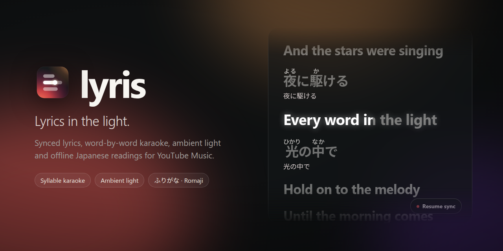

<p align="center">
  
</p>

<h1 align="center">Lyris</h1>

<p align="center">
  <b>Lyrics in the light.</b><br>
  Synced lyrics with word-by-word karaoke, ambient light, and offline Japanese readings for YouTube Music.
</p>

<p align="center">
  
  
  
  
  <a href="LICENSE"></a>
</p>

<p align="center">
  <a href="#install">Install</a> ·
  <a href="#features">Features</a> ·
  <a href="#controls">Controls</a> ·
  <a href="#privacy">Privacy</a> ·
  <a href="#development">Development</a>
</p>

---

Lyris replaces YouTube Music's lyrics tab with time-synced lyrics in an Apple Music-style layout. The current line fills word by word as it's sung, and the player glows with colours taken from the video or album art. Japanese lyrics can be shown with furigana, romaji or kana. Readings come from a dictionary bundled with the extension, so they work offline.

## Features

### 🎤 Synced lyrics and karaoke
- **Apple Music typography.** The active line is 40px, weight 750, tracking −0.02em, colour `#F8F6F2`. Other lines are dimmed and slightly blurred.
- **Word and syllable karaoke.** A left-to-right fill (`--fill`) with a soft glow and a 1px lift on the word being sung.
- **Steady follow position.** The playing line stays at `clamp(height × 0.24, 80px, 120px)` from the top, directly under the native tabs.
- **Resume sync.** Scroll away and a small pill appears. Click it to jump back to the current line.
- **Click to seek, Alt-click to calibrate.** Click a line to jump to it. Alt- or Shift-click a line to set that song's sync offset to the current playback position. The offset is saved for that song.

### 🌟 Ambient light
- **Edge projection.** Samples the outer edges of the video or album art and spreads them out across the player in many bands.
- **Separate horizontal and vertical spread**, so the glow stays balanced around YouTube Music's off-centre player.
- **Sliders** for intensity, spread (up to 400%), blur, saturation and fade duration.

### 🇯🇵 Offline Japanese readings
- **Bundled dictionary** of 3,500+ kanji and compound readings. No downloads, no delay.
- **Five script modes:** Furigana (readings above the kanji), Romaji, Hiragana, Katakana, or Original only.
- **Two-line display.** Optionally keep the original Japanese line under the reading.
- **Line translation (optional).** English translation under each Japanese line, via Google Translate. Off by default.

### 🔀 Lyrics from many sources
- **Priority list of sources:** LRCLIB → NetEase Music (网易云音乐) → KuGou (酷狗音乐) → YouTube captions → YouTube Music's own lyrics. QQ Music is available but off by default because its public service is unreliable.
- **Match checking.** Title, artist and duration are compared before lyrics are accepted. Junk entries and the wrong language version are rejected.
- **Covers.** Recognises covers, "歌ってみた" uploads and VTuber uploads, and finds the original song's synced lyrics.
- **Ad-aware.** During an ad, Lyris shows "Lyrics after the ad" instead of searching for the ad. Lyrics load when the song starts.
- **Manual search.** If Lyris picks the wrong song, click *Wrong song? Find another* to search and choose the right lyrics.

### ⚙️ Settings in the page
- **Two buttons in the player bar:** *Show lyrics* opens the lyrics pane, even for tracks where YouTube Music has none. *Lyris settings* opens a 352px dark glass panel.
- **Three sections:** Lyrics, Light and Sources, each with its own reset.
- **Keyboard-friendly.** Every control can be reached with Tab and has a visible focus ring. Esc closes the panel and returns focus to the settings button.
- The toolbar popup offers the same settings. Changes apply to open YouTube Music tabs immediately.

## Install

> A Chrome Web Store listing is coming. Until then, install it manually as an unpacked extension.

1. Download the latest `lyris-v1.0.0.zip` from [Releases](https://github.com/Kwan-desu/lycris/releases) and unzip it, or clone the repo:
   ```bash
   git clone https://github.com/Kwan-desu/lycris.git
   ```
2. Open `chrome://extensions` (or `edge://extensions` / `brave://extensions`).
3. Turn on **Developer mode** (top right).
4. Click **Load unpacked** and select the folder that contains `manifest.json`.
5. Open [music.youtube.com](https://music.youtube.com), play a song, and click the lyrics button in the player bar.

Works in Chromium-based browsers that support Manifest V3: Chrome, Edge, Brave, Vivaldi and Opera.

## Controls

| Action | How |
| :-- | :-- |
| Show / hide lyrics | Lyrics button in the player bar |
| Open settings | Settings button in the player bar. Close with `Esc` |
| Jump to a line | Click it, or focus it with `Tab` and press `Enter` |
| Calibrate sync to this line | `Alt`/`Shift` + click (or `Alt`/`Shift` + `Enter`) |
| Nudge sync | `−0.5s` `−0.1s` `+0.1s` `+0.5s` in the lyrics footer. `↺` resets it |
| Return to the playing line | **Resume sync** pill (bottom right) |
| Wrong lyrics? | **Wrong song? Find another** in the lyrics footer |

## Troubleshooting

- **No lyrics button.** Reload the YouTube Music tab after installing or updating the extension.
- **Lyrics are early or late.** Alt-click the line that's being sung, or use the nudge buttons. The offset is saved for that song only.
- **Wrong lyrics.** Use *Wrong song? Find another*, or change the source order under **Sources**.
- **Nothing found.** Some songs aren't in any lyrics database. Try turning on QQ Music under **Sources**.

## Privacy

Lyris has no analytics, ads or tracking, and no servers of its own. To find lyrics it sends the current song's title, artist and duration to the lyrics services you have turned on. Lyric lines are sent to Google Translate only if you turn on line translation. Settings stay in your browser profile. See [PRIVACY.md](PRIVACY.md).

## Development

Needs Node.js 18 or later. There are no dependencies.

```bash
npm test          # 30+ unit and contract tests (LRC parsing, karaoke timing, readings, matching, waterfall)
npm run check     # syntax-check every script
npm run package   # build dist/lyris-v<version>.zip with only the runtime files
```

Optional end-to-end test: loads the unpacked extension into headless Chromium against a mock YouTube Music page. All network traffic is stubbed.

```bash
npm i --no-save playwright-core@1.48.2 && npx playwright-core install chromium
npm run test:e2e
```

```
manifest.json       MV3 manifest
content.js / .css   Lyrics view, karaoke engine, ambient light, in-page settings
background.js       Lyrics sources, match scoring, translation
kanji_dict.js       Offline kanji / compound reading dictionary
popup/              Toolbar popup
tests/              node:test unit + contract tests, Playwright E2E
docs/               Icon source (SVG) and social preview image
```

## Credits

Lyrics come from [LRCLIB](https://lrclib.net), NetEase Music, KuGou and QQ Music. Lyris is not affiliated with YouTube, Google or Apple.

## License

[MIT](LICENSE) © Kwan-desu
